<a href="https://bestcode.pt"><picture><source media="(prefers-color-scheme: dark)" srcset="assets/header-dark.svg"><source media="(prefers-color-scheme: light)" srcset="assets/header-light.svg"></picture></a>

  
  
  

Faço sites, lojas online e sistemas de gestão para negócios, do design ao servidor onde correm. Tenho o meu próprio alojamento (painel, deploy, email, bases de dados) e é lá que estes projetos vivem.

 

<picture><source media="(prefers-color-scheme: dark)" srcset="assets/s-prod-dark.svg"><source media="(prefers-color-scheme: light)" srcset="assets/s-prod-light.svg"></picture>

<b>PRODUTOS BESTCODE</b>

<a href="https://bestcode.pt"><picture><source media="(prefers-color-scheme: dark)" srcset="assets/cards/site-dark.svg"><source media="(prefers-color-scheme: light)" srcset="assets/cards/site-light.svg"></picture></a><picture><source media="(prefers-color-scheme: dark)" srcset="assets/cards/shell-dark.svg"><source media="(prefers-color-scheme: light)" srcset="assets/cards/shell-light.svg"></picture>

<a href="https://web.bestcode.pt"><picture><source media="(prefers-color-scheme: dark)" srcset="assets/cards/cp-dark.svg"><source media="(prefers-color-scheme: light)" srcset="assets/cards/cp-light.svg"></picture></a><a href="https://invoices.bestcode.pt"><picture><source media="(prefers-color-scheme: dark)" srcset="assets/cards/invoices-dark.svg"><source media="(prefers-color-scheme: light)" srcset="assets/cards/invoices-light.svg"></picture></a>

<b>SITES DE CLIENTES</b>

<a href="https://casadasmadeirasriza.com"><picture><source media="(prefers-color-scheme: dark)" srcset="assets/cards/cdm-dark.svg"><source media="(prefers-color-scheme: light)" srcset="assets/cards/cdm-light.svg"></picture></a><a href="https://cristalgravacoes.store"><picture><source media="(prefers-color-scheme: dark)" srcset="assets/cards/cristal-dark.svg"><source media="(prefers-color-scheme: light)" srcset="assets/cards/cristal-light.svg"></picture></a>

<a href="https://web.bestcode.pt/sites/southclinic/"><picture><source media="(prefers-color-scheme: dark)" srcset="assets/cards/southclinic-dark.svg"><source media="(prefers-color-scheme: light)" srcset="assets/cards/southclinic-light.svg"></picture></a><a href="https://bestcode.pt/kyoosoku/"><picture><source media="(prefers-color-scheme: dark)" srcset="assets/cards/kyoosoku-dark.svg"><source media="(prefers-color-scheme: light)" srcset="assets/cards/kyoosoku-light.svg"></picture></a>

<a href="https://migueldias.com"><picture><source media="(prefers-color-scheme: dark)" srcset="assets/cards/migueldias-dark.svg"><source media="(prefers-color-scheme: light)" srcset="assets/cards/migueldias-light.svg"></picture></a><a href="https://bestcode.pt"><picture><source media="(prefers-color-scheme: dark)" srcset="assets/cards/next-dark.svg"><source media="(prefers-color-scheme: light)" srcset="assets/cards/next-light.svg"></picture></a>

<b>COMUNIDADES</b>

<a href="https://bestcode.pt/gym/"><picture><source media="(prefers-color-scheme: dark)" srcset="assets/cards/gym-dark.svg"><source media="(prefers-color-scheme: light)" srcset="assets/cards/gym-light.svg"></picture></a><a href="https://redeglowing.com"><picture><source media="(prefers-color-scheme: dark)" srcset="assets/cards/glowing-dark.svg"><source media="(prefers-color-scheme: light)" srcset="assets/cards/glowing-light.svg"></picture></a>

 

<picture><source media="(prefers-color-scheme: dark)" srcset="assets/s-oss-dark.svg"><source media="(prefers-color-scheme: light)" srcset="assets/s-oss-light.svg"></picture>

<a href="https://github.com/Crazed0/prison-network-br-core"><picture><source media="(prefers-color-scheme: dark)" srcset="assets/cards/prison-dark.svg"><source media="(prefers-color-scheme: light)" srcset="assets/cards/prison-light.svg"></picture></a><a href="https://github.com/Crazed0/CS2-SimpleAdmin"><picture><source media="(prefers-color-scheme: dark)" srcset="assets/cards/cs2-dark.svg"><source media="(prefers-color-scheme: light)" srcset="assets/cards/cs2-light.svg"></picture></a>

<a href="https://github.com/Crazed0/raft-mods"><picture><source media="(prefers-color-scheme: dark)" srcset="assets/cards/raft-dark.svg"><source media="(prefers-color-scheme: light)" srcset="assets/cards/raft-light.svg"></picture></a>

Prison Network: <a href="https://github.com/Crazed0/prison-network-br-core">core</a> · <a href="https://github.com/Crazed0/prison-network-br-prison">prison</a> · <a href="https://github.com/Crazed0/prison-network-br-market">market</a> · <a href="https://github.com/Crazed0/prison-network-br-clans">clans</a> · <a href="https://github.com/Crazed0/prison-network-br-hub">hub</a> · <a href="https://github.com/Crazed0/prison-network-br-announce">announce</a> &nbsp;|&nbsp; CS2: <a href="https://github.com/Crazed0/CS2-SimpleAdmin">SimpleAdmin</a> · <a href="https://github.com/Crazed0/cs2-WeaponPaints">WeaponPaints</a> · <a href="https://github.com/Crazed0/cs2-retakes">Retakes</a> · <a href="https://github.com/Crazed0/AutomaticAds-CS2">AutomaticAds</a> &nbsp;|&nbsp; Raft: <a href="https://github.com/Crazed0/raft-mods">raft-mods</a> &nbsp;|&nbsp; Outros: <a href="https://github.com/Crazed0/waveup">wave-up.me</a> · <a href="https://github.com/Crazed0/bestcode-cp">bestcode-cp</a>

  

<picture><source media="(prefers-color-scheme: dark)" srcset="assets/s-stack-dark.svg"><source media="(prefers-color-scheme: light)" srcset="assets/s-stack-light.svg">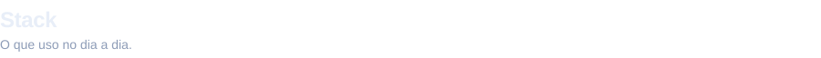</picture>

  <picture><source media="(prefers-color-scheme: light)" srcset="https://skillicons.dev/icons?i=ts,react,nextjs,vite,tailwind,threejs,nodejs,express,mysql,electron&theme=light&perline=10"></picture>
   
  <picture><source media="(prefers-color-scheme: light)" srcset="https://skillicons.dev/icons?i=linux,nginx,cloudflare,git,java,cs,php,discord&theme=light&perline=10"></picture>

 

<b>Precisas de um site ou de um sistema para o teu negócio?</b> <a href="https://bestcode.pt">Fala comigo em bestcode.pt →</a>

